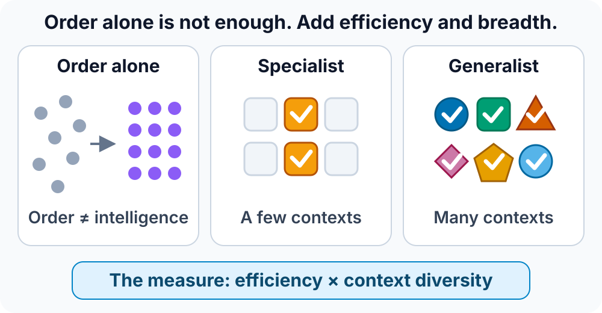
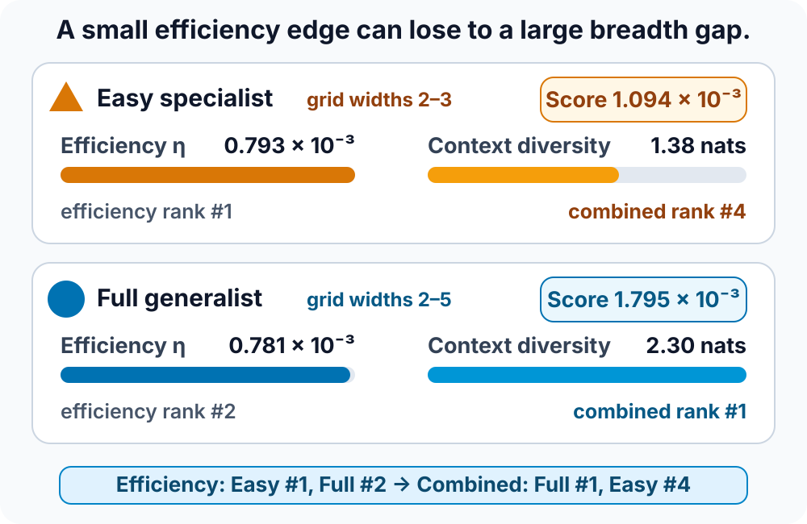

# Intelligence Entropy

[](https://github.com/dariocazzani/intelligence-entropy/actions/workflows/ci.yml)
[](https://doi.org/10.1007/978-3-032-33010-9_10)
[](https://www.python.org/downloads/)
[](LICENSE)

Can a system make goal-directed environmental progress efficiently, and keep
doing so across diverse situations? $I_{cd}$ is a behavioral diagnostic of
that demonstrated pragmatic competence.

<picture>
  <source media="(prefers-color-scheme: dark)" srcset="docs/assets/readme/icd-concept-dark.svg">
  
</picture>

## The measure

Producing order is not enough: crystals, thermostats, and other fixed processes
can reduce disorder within one narrow set of conditions. The proposed
diagnostic therefore combines efficient action with breadth across contexts.

```math
I_{cd}
=
\underbrace{\frac{-\Delta S}{W}}_{\text{efficiency }\eta}
\times
\underbrace{H(C)}_{\text{context diversity}}
```

| Term | Meaning |
|---|---|
| $-\Delta S$ | Reduction in domain-defined, goal-relative environmental disorder |
| $W$ | Environmental action cost, not compute, energy, or runtime |
| $H(C)$ | Shannon diversity of evaluator-defined contexts in which behavior is observed |

The definitions of $S$, $W$, and the context partition belong to an
evaluation. Scores are comparable within a fixed operationalization, not
directly across unrelated domains.

## Why breadth changes the result

In the sliding-puzzle experiment, every restricted agent uses the same greedy
Manhattan-distance heuristic on its allowed grid sizes and random actions
elsewhere. The Easy specialist is slightly more efficient, but the Full agent
demonstrates useful behavior across more contexts. Accounting for that context
diversity flips their ranking.

<picture>
  <source media="(prefers-color-scheme: dark)" srcset="docs/assets/readme/sliding-ranking-dark.svg">
  
</picture>

## Four experiments, one progression

| Experiment | Role in the argument | Implementation |
|---|---|---|
| Coupled regulation | Isolates efficiency while every agent sees the same three contexts | [`run_all.py`](experiments/run_all.py) |
| Sliding puzzle | Varies efficiency and competence range using restricted versions of the same heuristic | [`run_sliding_puzzle_heuristic.py`](experiments/run_sliding_puzzle_heuristic.py) |
| IPC 2023 planning | Tests efficiency and domain coverage using archival competition data | [`run_ipc.py`](experiments/run_ipc.py) |
| ARC | Uses compressed goal residuals to distinguish structured near-misses hidden by exact-match accuracy | [`run_arc_compression.py`](experiments/run_arc_compression.py) |

> [!NOTE]
> $I_{cd}$ is a post-hoc behavioral diagnostic, not a training objective. It
> measures demonstrated environmental competence, not learning speed,
> computation, understanding, creativity, consciousness, or latent capability.

## Try the measure

Install the project and development dependencies:

```bash
uv sync --extra dev
```

```python
from ie.measure import i_cd

score = i_cd(
    delta_s=-2.0,
    work=1.0,
    contexts=[0, 1, 2, 3],
)
print(score)  # 2.772588722239781
```

Run the test suite:

```bash
uv run pytest tests/ -v --tb=short
```

## Reproducing the experiments

The experiments have different runtime and data requirements. ARC rule-based
results can be recomputed from the included tasks; the published LLM caches are
not tracked. IPC requires the external benchmark repository and competition
properties. The full synthetic pipeline trains several agents over 50 seeds.

See **[Reproducing the paper](docs/reproducing-results.md)** for exact commands,
inputs, outputs, and caveats.

## Paper

**[Efficient Entropy Reduction as a Substrate-Independent Measure of Pragmatic
Intelligence](https://doi.org/10.1007/978-3-032-33010-9_10)**<br>
Dario Cazzani, *Artificial General Intelligence: 19th International Conference,
AGI 2026*, Springer LNCS 16854, pp. 154–171.

[Read the repository copy](paper/main.pdf) ·
[View the source](paper/main.tex)

<details>
<summary>Citation</summary>

```bibtex
@inproceedings{cazzani2026entropy,
  author    = {Cazzani, Dario},
  editor    = {Iklé, Matthew and Franz, Arthur and Kemendo, Andrew and Lowy, Haley},
  title     = {Efficient Entropy Reduction as a Substrate-Independent Measure of Pragmatic Intelligence},
  booktitle = {Artificial General Intelligence},
  series    = {Lecture Notes in Computer Science},
  volume    = {16854},
  pages     = {154--171},
  publisher = {Springer Nature Switzerland},
  address   = {Cham},
  year      = {2026},
  doi       = {10.1007/978-3-032-33010-9_10},
  isbn      = {978-3-032-33010-9},
  url       = {https://doi.org/10.1007/978-3-032-33010-9_10}
}
```

</details>

## License

[MIT](LICENSE)
